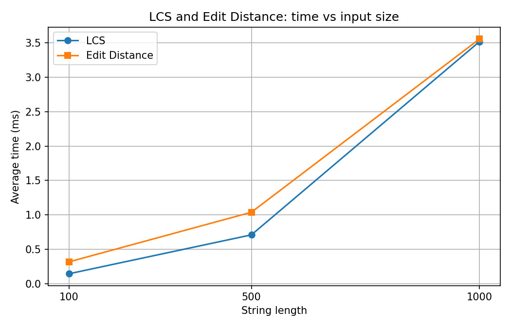
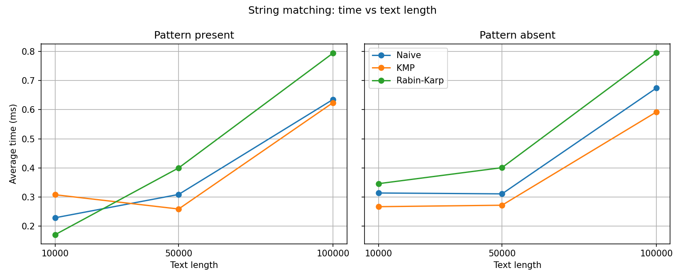
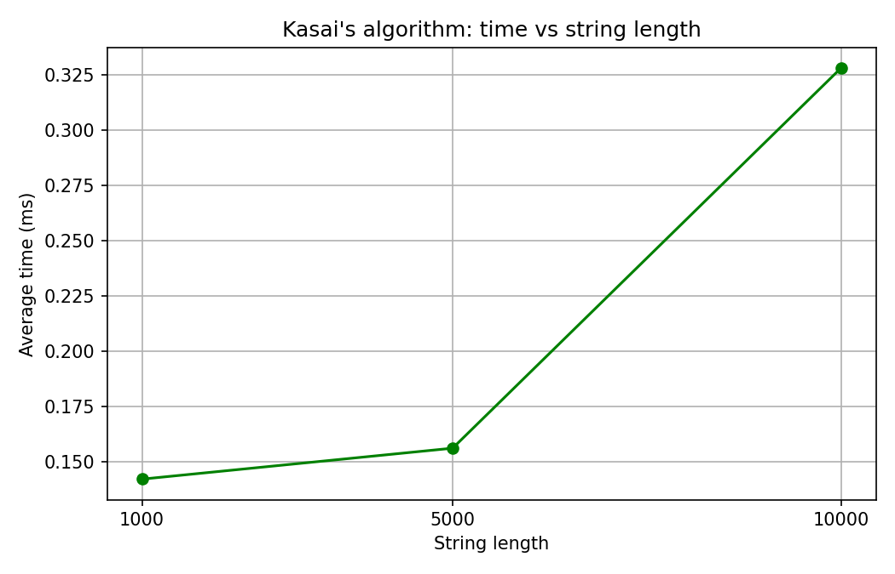

# Assignment 4 — Text Analysis: Dynamic Programming and String Algorithms

A Java 17 project (no external libraries, no build tool) that implements and compares dynamic programming algorithms, string matching algorithms, and Kasai's LCP algorithm.

## 1. Problem Description and Algorithm Overview

| Part | Algorithm | What it does |
|---|---|---|
| A | Longest Common Subsequence (LCS) | Length of the longest subsequence shared by two strings |
| A | Edit Distance (Levenshtein) | Minimum number of insertions, deletions and substitutions that turn one string into another |
| B | Naive matching | Tries every shift of the pattern and compares character by character |
| B | Knuth–Morris–Pratt (KMP) | Uses the LPS table of the pattern so the text pointer never moves back |
| B | Rabin–Karp | Compares a rolling hash of the pattern with a rolling hash of each text window |
| C | Kasai's algorithm | Builds the LCP array from a string and its suffix array in linear time |

All matching algorithms return **all** starting indices of the pattern in the text.

### Why the recurrences are correct

**LCS.** Let `dp[i][j]` be the LCS length of the first `i` characters of string A and the first `j` characters of string B.
- Base case: `dp[0][j] = dp[i][0] = 0`, because an empty string has no common subsequence with anything.
- If `A[i-1] == B[j-1]`, these two characters can be matched at the end of an optimal common subsequence, so `dp[i][j] = dp[i-1][j-1] + 1`.
- Otherwise at least one of the two last characters is not used, so `dp[i][j] = max(dp[i-1][j], dp[i][j-1])`.

**Edit Distance.** Let `dp[i][j]` be the minimum number of operations to turn the first `i` characters of A into the first `j` characters of B.
- Base cases: `dp[i][0] = i` (delete `i` characters) and `dp[0][j] = j` (insert `j` characters).
- The last operation is one of three: delete `A[i-1]` (`dp[i-1][j] + 1`), insert `B[j-1]` (`dp[i][j-1] + 1`), or match/substitute (`dp[i-1][j-1] + cost`, where `cost` is 0 if the characters are equal and 1 otherwise). `dp[i][j]` is the minimum of the three.

### How KMP avoids repeated comparisons
The LPS table stores, for every prefix of the pattern, the length of the longest proper prefix that is also a suffix of that prefix. When a mismatch happens after `j` matched characters, the last `LPS[j-1]` matched characters are already known to match the beginning of the pattern. KMP moves only the pattern index to `LPS[j-1]` and keeps the text index where it is. The text pointer never goes back, so no text character is compared again from an older shift.

### How Rabin–Karp handles hash collisions
The hash of the next window is computed in O(1) from the previous one:
`hash = ((hash - text[i] * BASE^(m-1)) * BASE + text[i+m]) mod MOD`.
Two different strings can have the same hash (a collision), so equal hashes are only a hint. When the hashes are equal, the algorithm compares the real characters. If they differ, the window is rejected, and if they are equal, the index is added to the result. Because of this verification step the result is always correct.

### What the LCP array represents
For a string and its suffix array `SA` (the starting indices of all suffixes in sorted order), `lcp[k]` is the length of the longest common prefix of the suffixes `SA[k-1]` and `SA[k]`. In this project `lcp[0] = 0`.
Example for `banana`: `SA = [5, 3, 1, 0, 4, 2]` (`a`, `ana`, `anana`, `banana`, `na`, `nana`) and `LCP = [0, 1, 3, 0, 0, 2]`.

## 2. Implementation Decisions and Assumptions

- **Language and tools:** Java 17, standard library only. Tests are plain Java classes (no JUnit).
- **Alphabet:** `abcd` for all random strings. **Random seed:** `42` (`java.util.Random`).
- **Empty pattern:** every matcher returns an **empty list** (an empty pattern is treated as "no occurrences").
- **Pattern longer than the text:** every matcher returns an empty list.
- **Rabin–Karp:** `BASE = 31`, `MOD = 1,000,000,007`. Every hash match is verified by comparing characters.
- **Operation counts:** "comparisons" means character comparisons.
    - Naive: every comparison of a text character with a pattern character.
    - KMP: comparisons in the search and in the construction of the LPS table.
    - Rabin–Karp: only the character comparisons made when verifying a hash match (hash comparisons and hash updates are not counted).
- **Suffix array for Kasai:** a simple construction (sorting suffix indices by comparing suffixes) is used. It is only used to prepare the input and is **not** part of the timed region. For the test, a manually verified suffix array is also used.
- **LCP convention:** `lcp[0] = 0`, and `lcp[k]` compares `SA[k-1]` and `SA[k]`.
- **Absent pattern in the experiments:** it is created from the present pattern by replacing the last character with `z`, which is not in the alphabet, so it can never occur in the text.

## 3. Complexity Analysis

Notation: `n` and `m` are the string lengths for the DP algorithms. For matching, `n` is the text length and `m` is the pattern length.

| Algorithm | Main operation / recurrence | Best case | Worst case | Auxiliary space | Justification |
|---|---|---|---|---|---|
| LCS | `dp[i][j] = dp[i-1][j-1] + 1` if equal, else `max(dp[i-1][j], dp[i][j-1])` | O(nm) | O(nm) | O(nm) | Every cell of the (n+1)×(m+1) table is filled once in O(1) |
| Edit Distance | `dp[i][j] = min(dp[i-1][j]+1, dp[i][j-1]+1, dp[i-1][j-1]+cost)` | O(nm) | O(nm) | O(nm) | Same table, O(1) work per cell |
| Naive | Compare the pattern with the text at every shift | O(n) | O(nm) | O(1) | Best case: the first character mismatches at every shift. Worst case: long partial matches at many shifts (for example `aaaa...` and `aaab`) |
| KMP | LPS table, then one pass over the text | O(n + m) | O(n + m) | O(m) | LPS construction is O(m). The text index never moves back, and the pattern index drops at most as many times as it rose, so the search is O(n) |
| Rabin–Karp | Rolling hash, verify on hash match | O(n + m) | O(nm) | O(1) | Hash update is O(1) per position. Expected O(n + m) when collisions are rare. Worst case O(nm) when many windows have the same hash (or many windows really match) and each needs an O(m) verification |
| Kasai | For each suffix, extend the common length `h`, then decrease it by 1 | O(n) | O(n) | O(n) | `h` increases at most `2n` times in total because it decreases by at most 1 per step and never exceeds `n`. The `rank` and `lcp` arrays need O(n) space (the suffix array is the input) |

Theoretical complexity describes how the work grows with the input size. Measured execution time (section 6) also depends on the machine, the JVM and the data. Rabin–Karp has different expected and worst-case bounds: the expected bound assumes that hash collisions are rare, while the worst case assumes that many positions need a full O(m) check.

## 4. Testing Strategy and Results

All tests are in `src/tests` and are run with `AllTests`. A small `TestHelper` class prints `PASS` or `FAIL` for every check.

| Area | Cases tested |
|---|---|
| LCS | identical strings, completely different strings, empty string (both orders), classic example `ABCBDAB` / `BDCABA` = 4 |
| Edit Distance | identical strings, one empty string (both orders), substitution, insertion, deletion, classic example `kitten` / `sitting` = 3 |
| String matching | pattern at the beginning, in the middle, at the end; multiple (overlapping) occurrences; pattern absent; pattern longer than the text; empty pattern |
| Kasai | `banana` with the manually verified suffix array `[5, 3, 1, 0, 4, 2]` and expected LCP `[0, 1, 3, 0, 0, 2]`; the suffix array builder is also checked against the same manual result |

Every string-matching case is run on Naive, KMP and Rabin–Karp, and each one must return exactly the expected list of indices, so all three always return the same list.

**Result: 35 tests passed, 0 failed** (5 LCS + 7 Edit Distance + 21 string matching + 2 Kasai).

## 5. Experimental Setup

- **Input data:** random strings over the alphabet `abcd`, seed `42`. The same text and pattern are used for Naive, KMP and Rabin–Karp in each comparison.
- **Input sizes:**

| Experiment | Input sizes |
|---|---|
| LCS | two strings of length 100, 500, 1000 |
| Edit Distance | two strings of length 100, 500, 1000 |
| String matching | text length 10,000, 50,000, 100,000 (pattern length 20) |
| Kasai | string length 1,000, 5,000, 10,000 |

- **Patterns:** the *present* pattern is a substring of length 20 taken from the middle of the text. The *absent* pattern is the same pattern with the last character replaced by `z`.
- **Timing:** `System.nanoTime()`. Each timed experiment is run **5 times** and the **average** is reported. Before the 5 measured runs, 20 warm-up runs are executed and not counted, so the JIT compiler has time to optimize the code.
- **Excluded from timing:** input generation, suffix array construction, console output and file writing.
- **Operation counts:** character comparisons for string matching (see section 2).
- **Environment:** Java 17 (Temurin 17.0.20.1), Windows, IntelliJ IDEA. CPU / RAM: **(Intel Core i5-12genz, 16 GB RAM)**.

## 6. Results

Raw data is saved in `results/*.csv`.

### LCS and Edit Distance

| Length | LCS (ms) | Edit Distance (ms) |
|---|---|---|
| 100 | 0.143 | 0.316 |
| 500 | 0.709 | 1.038 |
| 1000 | 3.520 | 3.558 |



### String matching

| Text length | Pattern | Algorithm | Time (ms) | Comparisons | Occurrences |
|---|---|---|---|---|---|
| 10,000 | present | Naive | 0.229 | 13,433 | 1 |
| 10,000 | present | KMP | 0.308 | 12,544 | 1 |
| 10,000 | present | Rabin–Karp | 0.171 | 20 | 1 |
| 10,000 | absent | Naive | 0.314 | 13,433 | 0 |
| 10,000 | absent | KMP | 0.267 | 12,545 | 0 |
| 10,000 | absent | Rabin–Karp | 0.346 | 0 | 0 |
| 50,000 | present | Naive | 0.309 | 66,745 | 1 |
| 50,000 | present | KMP | 0.259 | 62,555 | 1 |
| 50,000 | present | Rabin–Karp | 0.400 | 20 | 1 |
| 50,000 | absent | Naive | 0.311 | 66,745 | 0 |
| 50,000 | absent | KMP | 0.272 | 62,557 | 0 |
| 50,000 | absent | Rabin–Karp | 0.401 | 0 | 0 |
| 100,000 | present | Naive | 0.635 | 133,550 | 1 |
| 100,000 | present | KMP | 0.624 | 125,070 | 1 |
| 100,000 | present | Rabin–Karp | 0.794 | 20 | 1 |
| 100,000 | absent | Naive | 0.674 | 133,550 | 0 |
| 100,000 | absent | KMP | 0.592 | 125,071 | 0 |
| 100,000 | absent | Rabin–Karp | 0.795 | 0 | 0 |



### Kasai's algorithm

| String length | Time (ms) |
|---|---|
| 1,000 | 0.142 |
| 5,000 | 0.156 |
| 10,000 | 0.328 |



## 7. Discussion: Theory vs Experiment

**LCS and Edit Distance.** Both algorithms fill an `n × m` table, so the work grows quadratically: doubling the length should make the work about 4 times bigger. From 500 to 1000 the measured time grew about 5.0× for LCS (0.709 → 3.520 ms) and 3.4× for Edit Distance (1.038 → 3.558 ms), which is close to the expected 4×. From 100 to 500 the expected growth is 25×, but the measured growth was only 5.0× for LCS and 3.3× for Edit Distance. At such small sizes the total time is a fraction of a millisecond, so fixed costs (allocating the table, timer resolution, JIT effects) hide the real growth. Edit Distance is a little slower per cell than LCS because each cell computes a minimum of three values.

**String matching, operation counts.** The comparison counts match the theory well and do not depend on timer noise. Naive needs about 1.34 comparisons per text position (13,433 for n = 10,000), because on a random text over 4 letters a mismatch is usually found at the first or second character, so Naive runs close to its best case, O(n). KMP needs about 1.25 comparisons per position, always below 2n, and slightly fewer than Naive. Both grow linearly: from 10,000 to 100,000 characters the counts grew about 9.9× (Naive) and 10.0× (KMP). Rabin–Karp makes only 20 character comparisons when the pattern is present (one successful verification of 20 characters) and 0 when it is absent, which means no hash collision happened.

**String matching, time.** All three algorithms show roughly linear growth, but the differences between them are mostly small (a few hundredths to a few tenths of a millisecond) and are of the same size as the measurement noise, so no strong ranking can be claimed from the times alone. The measured growth from 10,000 to 100,000 characters is only about 2–3×, not 10×, because the fixed overhead of a single call is large compared to a total time below 1 ms. Rabin–Karp has by far the fewest character comparisons, but it was not faster in time: it updates the rolling hash at every position, which uses multiplications and modulo operations, and this arithmetic costs more than the cheap character comparisons that Naive and KMP make on this random 4-letter data. KMP's advantage over Naive is also small here because Naive is almost at its best case. KMP's guarantee matters most for texts with many repeated partial matches, which random text does not have.

**Kasai.** The algorithm is linear in theory. The measured time doubled from 5,000 to 10,000 characters (0.156 → 0.328 ms), which agrees with O(n), but the step from 1,000 to 5,000 (0.142 → 0.156 ms) is much smaller than the expected 5×. Times this small are dominated by noise and fixed costs, so the operation count and the O(n) proof (`h` increases at most 2n times in total) are more reliable than the measured milliseconds.

**Theoretical vs measured.** Theoretical complexity is an upper or lower bound on how the work grows with the input, independent of the computer. Measured times depend on the hardware, the JVM and the data, and for the small inputs used here some measurements are below 1 ms and therefore noisy. For this reason the comparison counts are used as the main evidence for string matching, and the times are used only to see the general trend.

## 8. Conclusion: Main Trade-offs

- **LCS / Edit Distance:** both give exact answers with O(nm) time and O(nm) space. The table makes the recurrence simple and easy to verify, but memory grows quickly for long strings. Edit Distance answers "how different", LCS answers "how much is shared".
- **Naive:** the simplest code and no extra memory. It is fast on random text, where mismatches are found early, but its worst case is O(nm).
- **KMP:** guaranteed O(n + m) in every case, at the cost of an O(m) LPS table and more complex code. It is the safest choice when the input is unknown or has many repeated parts.
- **Rabin–Karp:** very few character comparisons and O(1) extra space, and it is easy to extend to many patterns, but it relies on a hash, so its worst case is O(nm), and the hash arithmetic costs time at every position.
- **Kasai:** builds the LCP array in O(n) time and O(n) space once a suffix array is available. The LCP array is useful for repeated substrings and string comparison, but the algorithm needs the suffix array as input.

## Project Structure

```
.
├── README.md
├── results/                  CSV results and plots
└── src/
    ├── dp/                   LongestCommonSubsequence, EditDistance
    ├── matching/             StringSearcher, NaiveSearcher, KmpSearcher, RabinKarpSearcher
    ├── suffix/               SuffixArrayBuilder, KasaiLcp
    ├── experiments/          RandomTextGenerator, Timer, experiments, Main
    └── tests/                TestHelper, test classes, AllTests
```

## How to Compile and Run

Requirements: JDK 17. Run the commands from the root of the repository.

**Windows (cmd):**
```
dir /s /b src\*.java > sources.txt
javac -d out @sources.txt
java -cp out tests.AllTests
java -cp out experiments.Main
```

**Linux / macOS:**
```
javac -d out $(find src -name "*.java")
java -cp out tests.AllTests
java -cp out experiments.Main
```

`AllTests` prints the result of every test and a summary. `Main` runs all experiments, prints the tables to the console and saves them in `results/` as CSV files. The plots in `results/` were drawn from these CSV files.